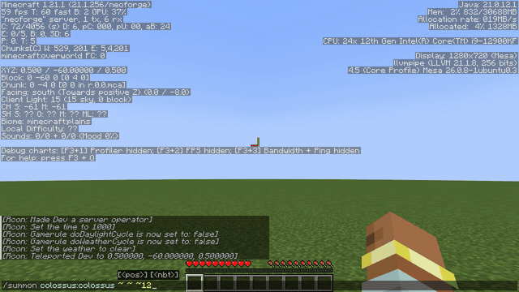
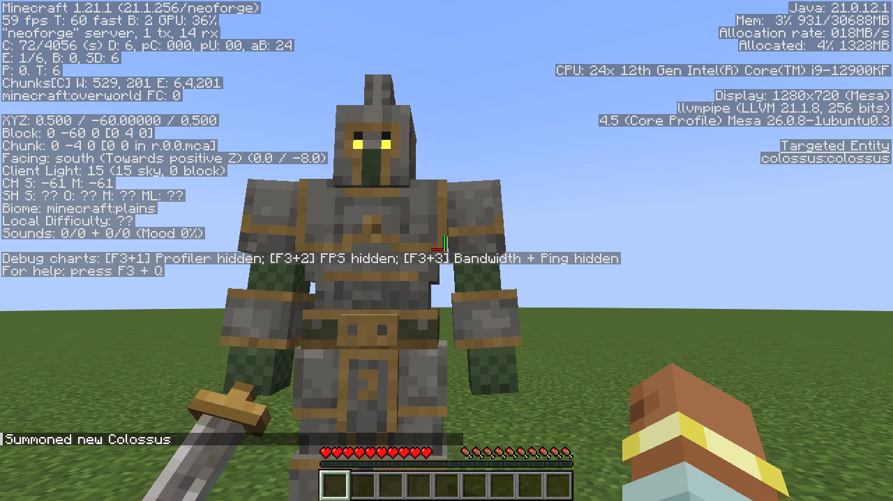
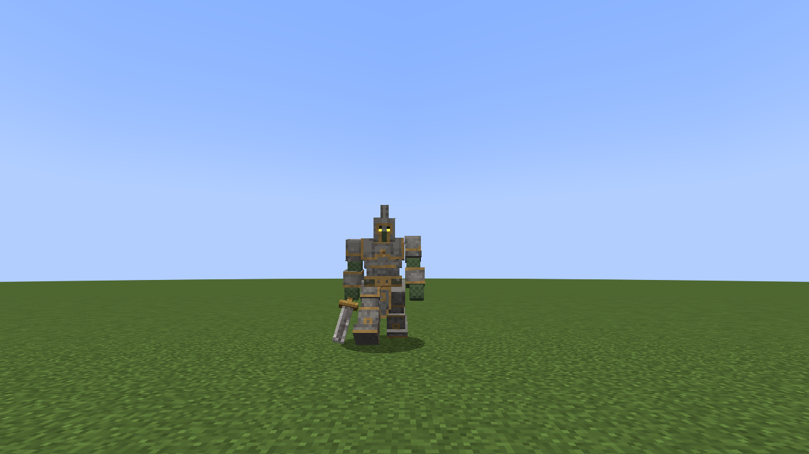
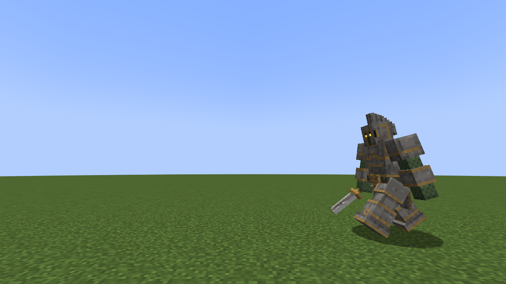

# Colossus — a walking stone knight for Minecraft 1.21.1 (NeoForge)

A NeoForge mod that adds the **Colossus**: a 3¼-block-tall armoured stone knight with a crested great helm, glowing
eye slits, gold-trimmed plate, chainmail arms and a stone sword. It walks up to the nearest player and stops about
3 blocks away. It is not hostile, so it also works on Peaceful. It never spawns naturally: summon it or use the spawn egg.

**How it was made:** [docs/HOW_IT_WAS_MADE.md](docs/HOW_IT_WAS_MADE.md) covers the whole route from a front/side/back
turnaround image to this walking mob. It describes the approach and tools, each step with the numbers used, how the
walk animation works, how the in-game footage was verified, and how to do the same for your own character.



The clip was recorded in-game with `record_video.sh` and trimmed to 14 s ([MP4](docs/colossus_ingame.mp4)). The GIF
above is a 9.6 s excerpt of it, downscaled to 640×360, starting as the typed command is sent. The player types `/summon colossus:colossus ~ ~ ~12` in chat, and the Colossus
walks up. The F3 overlay is the game reporting on itself:
- `Minecraft 1.21.1 (21.1.256/neoforge)` in the top left;
- the renderer on the right;
- with the crosshair on the mob, **Targeted Entity `colossus:colossus`**.



| Front | Side | Back |
|---|---|---|
|  |  |  |

All of these are in-game captures from the Minecraft 1.21.1 client with NeoForge 21.1.256, made by the test harness
below. The client is the NeoForge dev client (`./gradlew runClient`), running headless on Xvfb with Mesa llvmpipe
software rendering. That is why F3 shows `llvmpipe` instead of a GPU. In the three frames above, the HUD is hidden
with F1. `docs/screenshots/` holds the full bursts, shot with `./client_shoot.sh <dir> 8`: `walk_*` (toward the camera),
`side_*` (profile) and `back_*` (walking away).

## Play

1. Install Minecraft 1.21.1 with **NeoForge 21.1.256 or newer**. The jar declares `neoforge [21.1.256,)`.
2. Download `colossus-1.0.0.jar` from [Releases](https://github.com/vasiliy-mikhailov/minecraft-colossus/releases).
   Alternatives: build it yourself (below), or take the `colossus-jar` artifact of a
   [Build](https://github.com/vasiliy-mikhailov/minecraft-colossus/actions/workflows/build.yml) run, which needs a GitHub
   login and expires after 90 days.
3. Drop the jar into `mods/`. One jar serves both sides. For multiplayer:
   - put it in the server's `mods/`, since the server registers the entity and the spawn egg;
   - put it in every player's `mods/`, since clients need the model, renderer and textures. NeoForge won't let a client
     without the mod join.
4. In game (cheats on, or as an operator): `/summon colossus:colossus ~ ~ ~5`, or use the **Colossus Spawn Egg** from the
   Spawn Eggs creative tab.

| | |
|---|---|
| Health | 100 (50 hearts) |
| Speed | 0.23 (a heavy walk) |
| Knockback resistance | 1.0 |
| Hitbox | 1.5 × 3.3 blocks |
| AI | float → walk to the nearest player within 32 blocks (stops at ~3) → look at a player within 16 → wander (0.8× speed) → look around |

The approach goal prefers any living entity tagged `colossus_lure` within 32 blocks over the player. The harness uses
an invisible armor stand with that tag to film the side and back views. Without a lure the Colossus behaves as
described above.

## Build

```bash
./build.sh                      # Gradle inside eclipse-temurin:21-jdk; only Docker is needed
# or, with JDK 21 installed:
cd mod && ./gradlew build
```

Output: `mod/build/libs/colossus-1.0.0.jar`.

## Test harness (Docker)

The harness runs a real NeoForge server and a headless game client in Docker, then takes screenshots and video of the
Colossus walking. Nothing is published on host ports; the client and server talk over a private Docker network,
`mc-test`.

```bash
./build.sh
./server_up.sh                  # (re)creates NeoForge 1.21.1 server 'mc-server', runs the self-test -> SELFTEST PASS
./client_shoot.sh shots/run1    # dev client 'mc-client' joins as Dev; front/side/back walk bursts (10 frames each)
./record_video.sh shots/video   # (re)starts mc-server, ops Dev, F3 on, /summon typed in chat, 40 s recording -> raw.mp4 + still_*.png
./server_down.sh                # remove both containers (the world, network mc-test and images are kept)
```

- **Self-test:** loads the mod, summons a Colossus over RCON, checks it is still alive after 200+ ticks, and requires
  zero `Exception`/`ERROR` lines in the server log.
- **Client:** `./gradlew runClient` on Xvfb `:99` (1280×720) with Mesa llvmpipe, using
  `--quickPlayMultiplayer mc-server:25565`. The scene is staged over RCON. `client_shoot.sh` hides the HUD with
  `xdotool key F1` and grabs frames with `import -window root`. `record_video.sh` records the display with ffmpeg
  `x11grab`.
- **State:** the Gradle home, server world and RCON password live under `$COLOSSUS_DATA` (default `<repo>/.data`,
  gitignored). The dev client's game folder is `mod/run/` (gitignored). The scripts overwrite `mod/run/options.txt` to
  skip the first-launch screens.
- **Names:** containers `mc-server` and `mc-client`; network `mc-test`; images `mc-client-img` (from
  `docker/client.Dockerfile`) and `mc-client-live-img` (adds ffmpeg, for `record_video.sh`).
- **Requirements:**
  - Docker;
  - disk: about 2 GB under `$COLOSSUS_DATA`, plus about 2.5 GB of images (`itzg/minecraft-server:java21`,
    `eclipse-temurin:21-jdk` and the two client images);
  - about 6 GB of free RAM (2 GB server heap, the client JVM and Gradle);
  - a multi-core CPU, because rendering is done in software.
  
  The first run downloads the NeoForge server, game assets and Gradle dependencies.

## Model

`model/` holds the Colossus as a Minecraft entity model:

- `colossus.bbmodel`: Blockbench **Modded Entity** project. Open it to view or edit.
- `colossus.png` (128×128, box UV) and `colossus_eyes.png` (emissive eye slits, rendered with `RenderType.eyes`).
- Shape: 52 px (3.25 blocks) tall, 37 cubes.
- Bones: `root → body` (torso, belt, front/back tabard, back plate), `head` (helm + stepped crest), `right_arm → sword`,
  `left_arm`, `right_leg`, `left_leg`.
- Walk cycle in `ColossusModel.setupAnim`:
  - legs swing `cos(limbSwing·0.6662)·STRIDE·min(limbSwingAmount, 1)` with `STRIDE = 1.4`, in opposite phase;
  - arms counter-swing, the sword arm less;
  - the upper body bobs up to 1.5 px per footfall and rolls slightly.
  
  For a heavier gait, lower `STRIDE` in `ColossusModel.java` (and in `export.py`, if you regenerate).
- `previews/`: offline renders of the box model (3/4 view, walk cycle, texture layout). These are not in-game.

`model/generator/` is the Python (NumPy + Pillow) source of the model:
- **Geometry:** the 37 boxes are written by hand in `build.py`, and the pixel-art face patterns in `design.py`.
- **Reference sheet:** a front | side | back turnaround (`ref.png`, **not included**) supplies the per-texel shading, the
  sword-blade texels and the comparison overlays. `build.py` reads `ref.png` on import, so `export.py` and `preview.py`,
    which import it, fail without the sheet.
  - The sheet must be 794×422 and match the `VIEW` calibration in `build.py`: 7 px per model unit; centres at x=146.5
    (front), 386 (side) and 626.5 (back); ground at y≈412–415.
  - A different sheet only re-shades this knight. It will not model a new character.

```bash
cd model/generator && python3 export.py && python3 preview.py
```

This writes `colossus.png`, `colossus_eyes.png`, `ColossusModel.java`, `ColossusEyesLayer.java`, `colossus.bbmodel` and
preview PNGs to `model/generator/out/` (gitignored).

In the mod, `ColossusModel.java` and `ColossusEyesLayer.java` are this generator's output, with these changes:
- moved from package `net.colossus.client.model` to `com.colossus.client`;
- typed to `ColossusEntity` instead of a generic `T`;
- a `LAYER` alias added.

Geometry, UVs and `setupAnim` are unchanged. `ColossusRenderer` and `ColossusClient` are written by hand.

## Layout

```
mod/                  NeoForge 1.21.1 mod (ModDevGradle, Java 21), mod id `colossus`
  src/main/java/com/colossus/          Colossus (registration), ColossusEntity (AI + attributes)
  src/main/java/com/colossus/client/   ColossusModel, ColossusRenderer, ColossusEyesLayer, ColossusClient
  src/main/resources/assets/colossus/  textures, lang, spawn-egg item model
model/                Blockbench project, textures, offline previews, Python generator
docs/                 HOW_IT_WAS_MADE.md (approach + tools), in-game recording (GIF + MP4), screenshots
build.sh  server_up.sh  client_shoot.sh  record_video.sh  server_down.sh  docker/client.Dockerfile
```

## License

MIT. See [LICENSE](LICENSE). The ModDevGradle template files are © NeoForged, also under MIT
([mod/TEMPLATE_LICENSE.txt](mod/TEMPLATE_LICENSE.txt)). The mod compiles against Mojang's official mappings, with
Parchment parameter names. Those mappings are covered by Mojang's own license, whose text is at the top of the mappings
file that ModDevGradle downloads. This project is not affiliated with Mojang or Microsoft.
