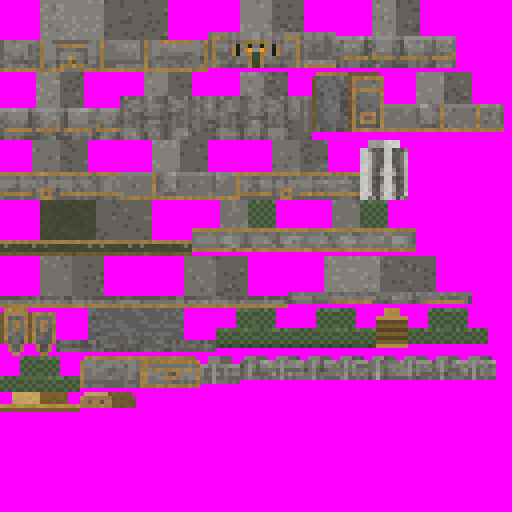
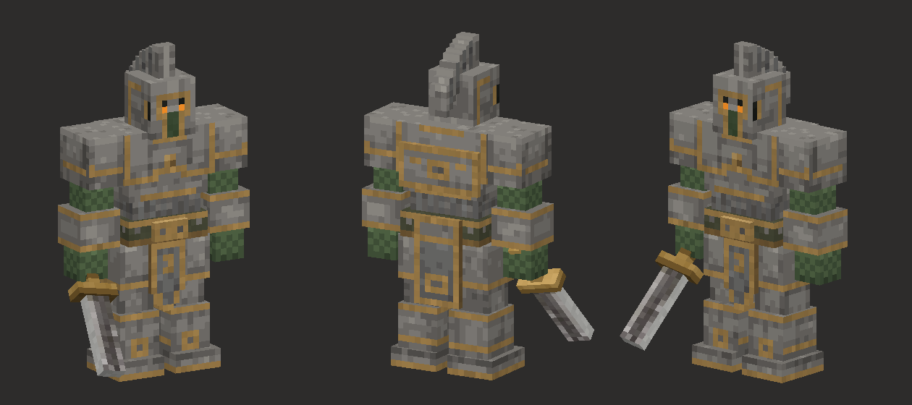
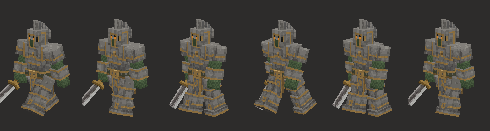

# How the Colossus was made: from a turnaround image to a walking Minecraft mob

This is a write-up of how this repo was actually produced, for modders who have their own reference art and want to
reproduce the approach. It describes what was done, including the parts that did not work and the corners that were cut.

**Short version:** there is no image-to-3D magic here. Every box was typed in explicitly (by an agent, the way a
person would), using measurements read off the reference sheet, and the face patterns were drawn as character grids.
The reference image contributed calibration, per-texel shading, reference colours for the hand-picked palettes and the
sword-blade texels, and it was the yardstick for every comparison. Everything was scripted, so the model rebuilds from
source in about a second. The generator is a script for this one character, not a general tool.

**Why not image-to-3D?** The first request was for a ComfyUI inference container. Image-to-3D weights (Pixal3D
multi-view, Trellis2 VAEs, Hunyuan3D-2 multi-view, BiRefNet for background removal) were downloaded for an existing
ComfyUI install, but that route was dropped before it was used. A Minecraft entity model is a set of boxes with box-UV
textures on a pivot rig, and a generated mesh would still have had to be rebuilt as boxes by hand. Nothing in this repo
came from an image-to-3D model.

**Who did what** (the agents are Claude, running in Claude Code as parallel subagents of a scripted workflow):
- **The human** supplied the reference sheet, asked for a walking Minecraft model, named the target (NeoForge
  1.21.1, tested in Docker on a Linux box) and reviewed the results.
- **The coordinating Claude session** turned the image into a written spec for the model agent, a separate and
  explicit step. The brief prescribed: about 52 units tall (about 1.6× a player); the list of signature parts; the
  bone hierarchy (root → body, head, arms with the sword as a child of the right arm, legs) with pivots at neck,
  shoulders and hips; the vanilla walk formula `cos(limbSwing*0.6662)*1.4*limbSwingAmount` with opposite-phase arms
  and a reduced sword arm; texturing by **sampling** the matching view and resizing with NEAREST; a 128 or 256 texture
  with an optional emissive eyes layer; a `.bbmodel`; side-by-side previews to look at and iterate on; and the 1.21.1
  `HierarchicalModel` API (not 1.21.2+ `EntityRenderState`).
- **The model agent** worked out everything specific to the sheet: the calibration, the coordinates of every box,
  the face grids, the palettes, the preview renderer and the `.bbmodel` mapping. It tried the prescribed sampling
  approach twice, found it gave mud, and switched to hand-drawn grids on its own (§3.4). It took about 20 minutes from
  first look at the sheet to a compile-checked Java model.
- **The harness agent**, in parallel, built the NeoForge project and the Docker build/server/client scripts and proved
  the whole pipeline end to end with a placeholder biped mob (64×64 texture), so the real model only had to be
  swapped in.
- **The integrate agent** swapped the real model in (hand edits, hitbox, eye height, the `colossus_lure` filming
  hook), built once and iterated on the **filming** script (camera placement, death puff, join detection) until clean
  front, side and back bursts were captured. No model change came from the in-game screenshots; its notes (the stride
  looks lunging, the eyes look yellow) were left as suggestions.
- **Later agents** recorded the F3 video, checked the bursts for authenticity, and re-ran it all from a clean clone.

## 1. Pipeline

```
 turnaround sheet (FRONT | SIDE | BACK, same scale, flat background)
        ▼  numpy foreground mask + ruler zoom crops, read by eye
 calibration: S = 7 ref px per model unit, view centres, ground lines      build.py  S, VIEW
        ▼
 box model in "H-space" (37 integer-size cubes, 8 bones incl. empty root)   build.py  part(), BONES
        ▼
 texture: hand-drawn face grids  +  shading sampled from the sheet          design.py, build.py  paint_part()
        ▼
 box-UV packing (128×128), eyes mask                                         build.py  pack(), export.py
        ├──► offline previews: z-buffer renderer, overlay on the reference   preview.py  ──┐
        │ ◄────────────────────────────────────────────────────────────────────── iterate ─┘
        ▼
 export: ColossusModel.java (geometry + setupAnim), ColossusEyesLayer.java, colossus.bbmodel   export.py
        ▼  hand edits (package, entity type/generics, LAYER alias)
 NeoForge 1.21.1 mod (mod/)  ──►  ./build.sh (Gradle in Docker)  ──►  colossus-1.0.0.jar
        ▼
 Docker: NeoForge server + RCON self-test  ──►  headless dev client (Xvfb + llvmpipe)
        ▼
 screenshot bursts / video with F3  ──►  look at them (fixes went into the filming, not the model)
```

## 2. Tools

| Tool | Version | Used for |
|---|---|---|
| Claude in Claude Code (parallel workflow subagents) | Claude Opus 5.5 | All code, measurements, iteration and verification. The agent "sees" images through Claude Code's file Read tool |
| Python 3 + NumPy + Pillow | numpy 2.5.3, Pillow 12.2.0 | Measuring the sheet, the box list, the texture, UV packing, the preview renderer, Java/.bbmodel emission. Run with plain host Python on the workstation, not in Docker |
| Blockbench `.bbmodel` format | format 4.10, Modded Entity, box UV | An editable copy of the model. It was written directly as JSON from Blockbench's exporter source (`js/formats/java/modded_entity.ts`) and has **never been opened in Blockbench** |
| NeoForge MDK (`MDK-1.21.1-ModDevGradle`) | NeoForge 21.1.256, ModDevGradle 2.0.148, Gradle 9.2.1, Parchment 2024.11.17 | The mod project |
| Java | 21 (`eclipse-temurin:21-jdk` image) | Compiling and running Gradle, including `runClient` |
| `itzg/minecraft-server:java21` | NeoForge 1.21.1 | Dedicated test server, plus `rcon-cli` for scripted commands |
| Xvfb, Mesa llvmpipe | Mesa 26.0.8, LLVM 21 | Headless display and software OpenGL 4.5 for the game client |
| xdotool, ImageMagick `import` | — | Sending keys to the game window and grabbing frames |
| ffmpeg | 8.0.1 (Ubuntu, in the client container); a local build on the workstation | `x11grab` recording in the container; trimming to MP4 and the palette GIF on the workstation |
| Docker | — | Every Gradle build, the compile check, and the server and client runs, on a Linux box. The Python generator and the MP4/GIF post-processing did not use Docker |

## 3. Step by step

### 3.1 The reference sheet

The input was a single 794×422 PNG on a dark flat background, with a title strip above three views: FRONT, SIDE
(profile facing left) and BACK. It shows a blocky armoured stone knight with a crested great helm, gold trim, a
tabard, chainmail arms and a sword held point-down. The sheet is not included in this repo.

What made it usable, and what yours needs: **three orthographic views at the same scale** (not perspective, not 3/4);
**a shared ground line** (the feet sit on nearly the same row in all three); **a flat, uniform background**, so a
colour-distance mask separates the figure; and **already blocky art**, which maps to cubes where organic art needs
much more interpretation.

### 3.2 Measuring and calibrating

1. **Mask:** take the background colour from a sample pixel (`im[200,280]` = `(46,45,45)`; `build.py` later uses
   `BG = (45,44,43)`). Mark as foreground every pixel whose summed |RGB − bg| is over 40, skipping the title rows
   (`m[:40] = False`; `build.py`'s sampling and `ref_shading()` ignore rows 0–40).
2. **Find the views:** project the mask onto columns. That gave FRONT x 19–253, SIDE x 277–428 and BACK x 520–763,
   with the silhouettes running from row 50 down to rows 411–414.
3. **Ruler zooms:** crop each view, upscale it 3× with nearest-neighbour, and draw tick marks every 10 px. The agent
   looked at these crops and read part edges off the ticks **by eye**. There was no automatic part segmentation.
4. **Choose the scale.** The silhouette is about 361 px tall. The brief's target height of 52 model units (about 1.6×
   a player) gives 361/52 ≈ 6.94, rounded to **S = 7 reference px per model unit**. One unit is one texel.
5. **Fix each view's centre and ground line** (`VIEW` in [`model/generator/build.py`](../model/generator/build.py)):
   front cx = 146.5, ground 412 (not the span midpoint: the sword widens one side); back cx = 626.5, ground 414,
   mirrored (`sx = −1`); side z = 0 at x = 386, ground 415, so `img_x = cx + 7·z`; in every view
   `img_y = ground − 7·H`. These numbers are specific to this sheet. `view_rect()` uses them to project a box's front or back face into the
   FRONT/BACK view; `paint_part()` does the same for side faces in the SIDE view, using z.

### 3.3 The box model ("H-space")

Parts are authored with `part(name, bone, x0,x1, H0,H1, z0,z1)` in
[`build.py`](../model/generator/build.py): x = Minecraft model x (the entity's right is −x), **H = height above the
ground**, z = model z (front is −z).

The exporter converts with `y = 24 − H`. That puts the feet at model y = 24, the standard living-entity origin, so
the renderer needs no scale or translate. Authoring in "height above ground" lets you type numbers straight off the
sheet's rulers.

Rules the code enforces, and why:
- **Every box size is a whole number** (`part()` asserts it). Box UV and Blockbench's Modded Entity format need
  integer sizes, and a whole-number size maps each face 1:1 to texels. Half-unit *positions* such as z = −6.5 are fine.
- **Arms and legs are authored for the right side and mirrored** with `mirror_x`. The left side gets its own boxes and
  UVs; the `.mirror()` UV flag is not used.

The final model has 37 cubes in 8 bones (`BONES`): an empty `root` (the Java part at offset (0, 24, 0) in MC
space), plus the seven below:

| Bone | Pivot (x, H, z) | Cubes |
|---|---|---|
| head | (0, 38, −1) | helm + 9 crest plates |
| body | (0, 21, 0) | chest, ribs, waist, belt, buckle, front tabard, back plate, back tabard |
| right_arm / left_arm | (∓11, 36, −0.5) | pauldron, mail, bracer, hand |
| sword (child of right_arm) | (−12, 18.5, −0.5), rotation (−0.7, 0, 0.18) | grip, guard, blade |
| right_leg / left_leg | (∓4.5, 21, 0) | thigh, tasset, shin, boot |

Widths and heights came from the front view; depths and the crest profile came from the side view. The sword is
authored hanging straight down from the fist, and the bone rotation tilts it forward and outward. A good reason to do
it this way: you can tune the tilt without moving any boxes.

The overall size is 52 tall, about 30 wide (the bracers reach x ±15) and about 12.5 deep (helm front z −6.5 to back
tabard z +6). The height sets the hitbox height: in `sized(1.5F, 3.3F)`, 3.3 just clears the 3.25-block crest. The
1.5-block width is narrower than the 1.875-block span; it was chosen, not derived. The eye height is 2.75 blocks (H 44,
just above the eye slits, which occupy H 42–43). The comments in `Colossus.java` ("29 px wide", "eye slits at 43 px") are slightly off.

### 3.4 Texture: what failed and what worked

The texture is **128×128, standard Minecraft box UV**. `pack()` is a shelf packer: it sorts the parts' UV strips
(2(w+d) × (d+h) each) by height and places them in rows, trying 128×128 first and falling back to 256×128 and then
256×256. [`export.py`](../model/generator/export.py) asserts that no texels overlap and nothing falls outside the
texture.

The first two attempts sampled colour straight from the reference:
1. **Attempt 1.** Each box face was projected into the matching view and reduced to w×h cells. Each cell took the
   single pixel of its dominant class (stone, gold, green or eye) nearest the cell centre; background holes were
   filled from neighbours, and only top and bottom faces got noise.
2. **Attempt 2.** A saturation-based gold classifier, the majority class per cell and its median colour, stone
   de-tinted to neutral grey, plus light per-face noise.

Both came out muddy. The sheet's detail is roughly twice as fine as a 52-unit model can hold, so 3-px gold trims and
Greek-key patterns averaged into brown noise. **Downsampling concept art does not give you pixel art.**

The sampling code (`sample_rect()`, `fill_invalid()`) is still in `build.py`, and the module docstring still says
"sampled texture", but nothing calls it any more. Only `classify()` is still used, by `ref_shading()`.

**Attempt 3, the one that shipped: hand-drawn grids plus shading taken from the reference.**
- [`model/generator/design.py`](../model/generator/design.py) `design(name, w, h, d)` returns a character grid per face
  for every part. The legend is:
  - stone tones: `S` stone, `L` light, `K` dark, `P` panel;
  - gold: `G`, `g` dark, `H` highlight;
  - `C` chainmail, `c` dark chainmail, `M` moss, `D` void, `E` eye, `W` leather;
  - `.` transparent.

  Gold trims, the visor and the eye slits are deliberate 1-texel lines. The Greek keys are simplified to rings and
  double squares. The tabard's pointed bottom is made of `.` cells, which is why the model uses a cutout render type.
  Grids are written for the right-side part and mirrored for the left. An assert checks every grid's size against its
  face. Here is the helm's front face:
  ```
  SSSLLSSS
  SSSLLSSS
  SGGGGGGS
  SGDLLDGS     D = dark visor slot
  SGELLEGS     E = eye texel (also copied into the emissive eyes texture)
  SGGMMGGS
  ...
  ```
- `ref_shading()` in `build.py` projects each texel's cell into the matching view. It takes the median brightness
  of the non-background, non-gold, non-eye pixels in that cell (so green mail and moss pixels count too) and converts
  the offset from the face's median into steps of a 6-tone stone ramp, using (offset)/22 clipped to ±1. Front faces
  are shaded from FRONT, back faces from BACK, and side faces from SIDE, except parts marked `side_src='front'` (belt,
  buckle, mail, bracers, hands, tassets), whose side faces get no reference shading. Top and bottom faces are never
  shaded. The drawing therefore picks up the sheet's highlights and cracks without copying its pixels.
- `paint()` gives each texel a level of `BASE[char] + shading + Gaussian jitter (σ 0.33)`. Gold gets ±5% jitter, and
  chainmail is a checker pattern over a 4-step green ramp. The palettes (`STONE`, `GOLDS`, `GREEN`, `FLAT`) were
  hand-picked after measuring each material's colour percentiles on the sheet, then adjusted by eye against the
  comparison renders. They are not computed from the sheet.
- The noise comes from `np.random.default_rng(7)`, so the output is deterministic. **But the noise is consumed in
  part order, so adding or reordering a part changes the texture of every part after it.**
- The sword blade is the one face sampled directly: `blade_front()` walks along the diagonal blade in the front view
  and straightens it into a 4×13 face. The guard and grip are procedural: a noisy gold guard with a dark lower edge,
  and a brown grip wrapped in dark-gold stripes with gold end caps.
- **Eyes:** a colour mask inside the helm's front-face UV rectangle finds the two `E` texels.
  `colossus_eyes.png` is transparent except for those two texels. In game it is drawn with `RenderType.eyes`
  (full-bright, additive).

A tuning pass after looking at the comparisons darkened the gold, lowered the stone base levels, and reduced the
jitter and shading strength. The first texture was too bright and too busy.



### 3.5 Offline previews, and the iterate loop

[`build.py`](../model/generator/build.py) includes a small numpy renderer (`render()`). It is orthographic with a
z-buffer, nearest-texel lookup and alpha test. It rebuilds each cube's polygons with the same vertex and UV ordering
as Minecraft's `ModelPart.Cube`, so a wrong UV shows up in the preview exactly as it would in game.
[`preview.py`](../model/generator/preview.py) writes:
- `preview_compare.png` / `cmp_*.png` / `preview_front_side_back.png`: each reference view next to the model,
  rendered at the same 7 px/unit and aligned on that view's ground line and centre, plus an overlay that draws the
  model's silhouette edge in red on the reference. **These contain the reference image, so they are not in the repo.**
- `preview_3q.png`, `preview_walk.png` and `preview_texture.png`, which are in [`model/previews/`](../model/previews/).




The loop was: edit `build.py`/`design.py`, run it (about 1 s), and look at the overlays. About 12 runs found:
- the muddy sampled textures (§3.4);
- a camera pitch sign error that rendered the 3/4 views from below;
- the sword tip hitting the ground in the walk preview. The blade was shortened (H −3 → −1) and the tilt increased
  (xRot −0.6 → −0.7);
- the crest profile not matching the side view. Five coarse blocks became nine plates (the front one 2 units deep, the
  rest 1 unit), each stepping down 0.5–1 unit, with side faces alternating light/panel shading so the plates read.

Caveat: the walk preview uses its own hand-copied, softer pose, not the Java constants. Changing `STRIDE` does not
change `preview_walk.png`. Judge the gait in game.

### 3.6 Export

`python3 export.py` writes these to `model/generator/out/`:
- **`ColossusModel.java`.** `bone_java()` walks the bone tree and emits `texOffs(u,v).addBox(...)` for each cube
  (with a `// name` comment), plus `PartPose.offset`/`offsetAndRotation` for each bone. A child's offset is its
  pivot minus its parent's pivot. `setupAnim` is a fixed template (§4).
- **`ColossusEyesLayer.java`**, which extends `EyesLayer` with `RenderType.eyes`.
- **`colossus.bbmodel`**, with the texture embedded as base64. The coordinate mapping follows Blockbench's own Java
  exporter (`modded_entity.ts`): Blockbench x = −MC x, and group rotation = (−rx, −ry, +rz) in degrees, so a
  re-export should reproduce the same `addBox` calls. That round trip was never checked: the file has not been opened
  in Blockbench, and the eyes texture is not embedded in it.

Copying the output into the mod is manual. The hand edits are:
1. move both classes to package `com.colossus.client`;
2. replace the generic `<T extends Entity>` with `ColossusEntity` in both (the eyes layer becomes
   `EyesLayer<ColossusEntity, ColossusModel>`);
3. in `ColossusModel`, add `LAYER = LAYER_LOCATION`.

Before integration, the generated classes were compile-checked against the mod (`./gradlew compileJava` in Docker).

**Version trap** (a constraint set in the brief, not a bug the agents hit): this targets **1.21.1**, where models are
`HierarchicalModel<T>` with `setupAnim(entity, limbSwing, …)` and renderers are `MobRenderer<E, M>`. From 1.21.2,
Minecraft uses `EntityRenderState`: models take `setupAnim(S state)`, renderers get a third type parameter, and
`HierarchicalModel` is gone. Code and Blockbench exports for one side of that split do not compile on the other. Pin
your target version before generating anything.

## 4. Animating it

[`ColossusModel.setupAnim`](../mod/src/main/java/com/colossus/client/ColossusModel.java) (template in `export.py`):

```java
root().getAllParts().forEach(ModelPart::resetPose);   // start every frame from the rest pose
float phase  = limbSwing * 0.6662F;                     // vanilla biped walk frequency
float amount = Math.min(limbSwingAmount, 1.0F);         // 0 standing … 1 full walk
rightLeg.xRot = cos(phase)      * STRIDE * amount;      // STRIDE = 1.4 rad peak swing
leftLeg.xRot  = cos(phase + PI) * STRIDE * amount;      // opposite phase
rightArm.xRot = cos(phase + PI) * ARM_SWING * amount * SWORD_ARM_FACTOR; // 0.8 × 0.45
leftArm.xRot  = cos(phase)      * ARM_SWING * amount * FREE_ARM_FACTOR;  // 0.8 × 0.75
idle = cos(age*0.06)*0.03 + 0.03;  rightArm.zRot += idle;  leftArm.zRot -= idle;  // slow breathing sway
bob  = |cos(phase)| * BOB * amount + sin(age*0.06)*0.25;   // BOB = 1.5 px
body.y += bob; head.y += bob; rightArm.y += bob; leftArm.y += bob;  // +y is DOWN: sink on each footfall
body.zRot = cos(phase) * 0.04 * amount;                     // roll over the planted leg
head.yRot = netHeadYaw * DEG_TO_RAD;  head.xRot = headPitch * DEG_TO_RAD;
```

- `limbSwing` is the distance the entity has walked, and `limbSwingAmount` is how fast it is walking (0 to about 1).
  0.6662 is the vanilla biped stride frequency (per unit of `limbSwing`). It was kept as-is for a leg nearly twice as
  long as the vanilla 12-px one; foot sliding was not measured, so judge it in game.
- Each arm swings **opposite to the leg on its own side**: the right arm uses `phase + PI` while the right leg uses
  `phase`. The sword arm swings less (0.45), so the sword doesn't flail.
- `|cos|` peaks twice per cycle, once per footfall, so the body drops on every step. That is what makes it read as
  heavy. The legs are not bobbed, so the feet stay on the ground.
- `resetPose()` at the top is required, because the bob uses `+=` and would otherwise accumulate.
- Head yaw and pitch come straight from the look controller.

**Tuning:**
- **`STRIDE`** is the main control. 1.4 is the vanilla biped value and reads long and lunging from the side for a
  3-block knight; about 1.0 gives a heavier gait.
- `BOB` sets the weight.
- The arm factors set how much the upper body swings.
- The entity's `MOVEMENT_SPEED` attribute (0.23 here) sets ground speed. Whether the feet slide depends on leg
  length × swing × frequency against that speed; it was not measured.

Change the values in `ColossusModel.java`, and in `export.py` too if you regenerate the model. Then judge them in game.

## 5. Verifying in game

The mod side is ordinary NeoForge: `Colossus.java` registers the entity type, attributes and spawn egg;
`ColossusEntity.java` holds the AI; `client/ColossusClient.java` registers the layer definition and the renderer. The
harness scripts in the repo root are:

- **[`build.sh`](../build.sh):** `./gradlew build` inside `eclipse-temurin:21-jdk`, running as your uid, with a
  writable `HOME`/`GRADLE_USER_HOME` under `$COLOSSUS_DATA`.
- **[`server_up.sh`](../server_up.sh):** starts `itzg/minecraft-server:java21` on a private Docker network (no host
  ports), on a flat world on Peaceful with RCON enabled and the jar mounted. Then it runs a **self-test** over RCON:
  summon a Colossus, wait at least 200 game ticks, check that it still exists and read its Health (100), and require
  zero `Exception`/`ERROR` lines in the server log. It prints `SELFTEST PASS`.
- **[`client_shoot.sh`](../client_shoot.sh):** runs the NeoForge **dev client** (`./gradlew runClient`) in
  [`docker/client.Dockerfile`](../docker/client.Dockerfile) on Xvfb with Mesa llvmpipe.
  - A `build.gradle` hook passes `--quickPlayMultiplayer mc-server:25565` in through `MC_CLIENT_ARGS`.
  - A pre-seeded `mod/run/options.txt` skips the first-launch screens and sets `pauseOnLostFocus:false`.
  - The script waits for `Dev joined the game`, then stages the scene over RCON: fixed time, clear weather, and the
    player teleported to a fixed pose.
  - It waits 15–20 s for software chunk meshing, then summons the mob and grabs bursts with
    `xdotool key F1` + `import -window root`.
  - Front view: the mob walks at the camera. Side and back views: it walks toward an invisible armor stand tagged
    `colossus_lure`, which the approach goal prefers over the player. This is a filming hook built into the mod's AI.
- **[`record_video.sh`](../record_video.sh):** the same setup, plus F3 on. The client image has no ffmpeg, so the
  script first builds `mc-client-live-img` on top of `mc-client-img` with ffmpeg added. It makes `Dev` a server
  operator over RCON (`op Dev`) so the typed summon is allowed; the player then types
  `/summon colossus:colossus ~ ~ ~12` in chat with `xdotool type`, and ffmpeg `x11grab` records the display from
  inside the client container. The trimmed [MP4](colossus_ingame.mp4) and [GIF](colossus_ingame.gif) were cut from
  that recording with a local ffmpeg.

**How to tell the footage is real.** [`docs/screenshots/f3_targeted_entity.png`](screenshots/f3_targeted_entity.png)
shows, in the game's own overlay, `Minecraft 1.21.1 (21.1.256/neoforge)`, the llvmpipe renderer, `Targeted Entity
colossus:colossus`, and the chat line for a summon typed by the player; the server log attributes it to `Dev`, not RCON.

The offline previews cannot produce any of these. The F3 overlay and the server log's attribution of the typed summon
are the evidence for the video and the F3 stills; no agent independently reviewed the video. Separate review agents
checked the earlier `client_shoot.sh` bursts (`walk_*`, `side_*`, `back_*` in [`docs/screenshots/`](screenshots/)):
the file copy chain by md5, frame timestamps against the server log, the ground pixels back-projected onto the vanilla
grass texture under the scripted camera (FOV 70, pitch −8, i.e. tilted 8° up), sky/fog colour, the shadow, and the eye colour against
additive `RenderType.eyes` blending.

Caveats:
- All footage is from the dev client with software rendering, not a retail launcher on a GPU.
- The spawn egg was registered but never used in a harness run.

## 6. Doing it for your own character

**What carries over** (with light edits; the generator was written for one character, so expect to touch constants):
the H-space convention and `part()`/`mirror_x`/`BONES`, UV packing and its overlap check, `ref_shading()`/`paint()`,
the preview renderer and overlay comparison, the Java/.bbmodel emitters, the `mod/` skeleton and every harness script.

**What you must re-author by hand.** This is the real work, and the generator will not do it for you:
1. **Calibration**: `S` and `VIEW` (centres, ground lines, mirroring) for your sheet, and the title-strip and
   crop constants in `build.py`/`preview.py`. Use the mask + column projection + ruler-zoom method in §3.2.
2. **The box list**: every `part(...)` call and every bone pivot in `build.py`. Read widths and heights from the
   front view and depths from the side view. Keep sizes whole numbers. Put pivots where the joints are: the top of
   the leg, the shoulder, the neck.
3. **Face grids** in `design.py`: one branch per part name. Draw the defining lines (trim, eyes, emblems) at 1 texel.
   Do not expect detail finer than about half the sheet's resolution to survive.
4. **Palettes**: measure each material's colour percentiles on your sheet as a starting point, then pick and tune the
   ramps by eye against the comparison renders.
5. **Special faces**: `blade_front()` and its sample points are specific to this sword, and the eye mask is specific
   to the helm. Replace or delete them.

`ref.png` must sit in `model/generator/`. Then run `python3 export.py && python3 preview.py` and iterate on the
overlays until the red silhouette edge sits on the reference outline in all three views.

**In the mod:**
- Rename the mod id, package, classes, lang keys and texture paths (`colossus` is used throughout).
- Set the hitbox height and `eyeHeight` from your model's bounds (units ÷ 16 = blocks), pick a hitbox width (vanilla
  mobs are usually narrower than their arms' span), and set the shadow radius in the renderer.
- Set the attributes and AI goals in the entity class; drop the `colossus_lure` hook if you don't need it for filming.
- Paste in the generated model and eyes layer with the hand edits from §3.6. `HierarchicalModel` renders with
  `entityCutoutNoCull` by default, which is what alpha cutouts need.

**The manual alternative,** without the generator: put each reference view on a Blockbench background plane, model in
a **Modded Entity** project with box UV, paint the texture in Blockbench or a pixel editor, and export Java with the
1.17+ Mojang-mappings template, checking that it targets your version's API (§3.6). Paste the generated
`createBodyLayer` into `ColossusModel`, keep this repo's `setupAnim`, rename the bone fields to match your groups, and
reuse the renderer, registration and harness as they are.

That route gives you interactive editing, at the cost of scripted reproducibility and the overlay check.

**What the AI did versus what a person would do:** the agent did what a careful person would (measure on rulers,
type in boxes, draw pixel grids, compare, adjust), but as code, checked against rendered overlays instead of an
interactive viewport, with in-game screenshots as the final check. A person could do the same, or let an agent do the
tedious parts (calibration, UV packing, export, the harness) and draw the face grids themselves.

## 7. Lessons and gotchas

**Problems actually hit:**
- **Sampling concept art straight into a low-res texture gives mud.** The brief asked for it; two attempts failed.
  Draw the defining lines by hand and take only the shading from the art.
- **Preview-loop finds** (§3.5): a camera pitch sign error, the sword tip hitting the ground, the crest profile.
- **The hitbox must cover the tallest part.** The crest reaches 3.25 blocks, so a 3.0 hitbox was too short.
- **The eyes layer is additive and full-bright.** The base texel (255,150,40) plus the additive eyes texture
  (255,160,50) renders as yellow (255,252,75). Darken `colossus_eyes.png` (and/or the base eye texel) to get the
  colour you want.
- **Harness gotchas:**
  - `rcon-cli` needs `--` before negative coordinates, and its output must be stripped of ANSI codes.
  - Under `set -o pipefail`, `docker logs | grep -q` reports a miss when grep exits early. Let grep read all input
    (`grep -c ... >/dev/null`); all three scripts now do. The client scripts also pass `--since` so a join from an
    earlier run doesn't count.
  - Kick the player over RCON before stopping the client, or the server logs a Netty `ERROR` and the self-test fails.
  - Teleport the mob into the void before killing it, so the death puff doesn't show in the next shot.
  - Give the flat world explicit `GENERATOR_SETTINGS`; without them the first run logs a "No key layers" `ERROR`.
  - Mount the jar at `/mods`, not as a file bind under `/data/mods` (that leaves a root-owned placeholder).
  - Focus the window before xdotool keys, set `pauseOnLostFocus:false`, and give llvmpipe 15–20 s to mesh chunks.
- **Clean-clone testing found what the authors missed.** Re-running from a fresh clone found the first-run
  `SELFTEST FAIL` (the `GENERATOR_SETTINGS` fix above) and the root-owned placeholder. It also showed that an older
  jar left on the build box still carried the MDK's "All Rights Reserved" license; that was a stale local build, not
  a repo bug.

**Rules set up front** (from the brief or built into the code from the start, not problems hit):
- **1.21.1 versus 1.21.2+ model API.** Pin the version first (§3.6).
- **Integer box sizes**, or box UV and Blockbench break (`part()` asserts it).
- **Mirrored parts need mirrored grids.** `design()` swaps and mirrors east/west for the left side, or the trims would
  end up on the wrong edge.
- **Keep the reference out of anything you publish.** The compare previews embed it; publish only renders of your own
  model.

**Caveats and trade-offs:**
- **Seeded noise depends on part order**, so inserting a part re-noises everything after it.
- **The sword arm is straight.** The sheet bends the elbow; the rig tilts the sword bone instead, so the side view
  differs there. A bent elbow needs a forearm bone.
- **Check the gait in game**, not in the preview. The preview pose is an approximation.
